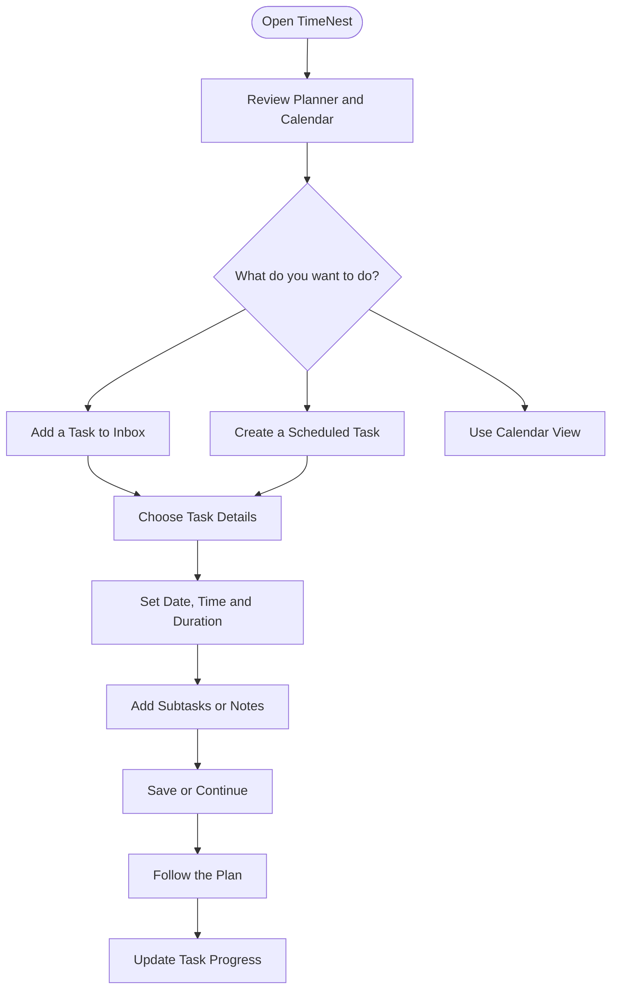

<div align="center">

# 📆 TimeNest

### Plan Smarter. Stay Focused. Make Every Day Count.

**Your personal space to organize tasks, plan your schedule, and build productive routines.**

[](https://timenest.ai.studio)
[](https://github.com/AryanKumawat21/TimeNest)

<br/>

*Plan your time. Make room for what matters.*

</div>

---

## 📸 Preview

### Main Planner Dashboard
<p align="center">
  

</p>

### Create and Customize Tasks
<p align="center">
  
  &nbsp;
  

</p>

### Calendar View
<p align="center">
  

</p>

---

## ✨ What is TimeNest?

**TimeNest** is a smart day-planning web application designed to make everyday planning feel simpler and more organized. It brings your tasks and schedule into a visual workspace so you can plan your day, keep track of activities, and stay focused on what matters.

🔗 **Try it now:** [timenest.ai.studio](https://timenest.ai.studio)

## 🚀 Highlights

- 🗓️ **Daily Planner** — view your day and organize scheduled activities.
- 📥 **Task Inbox** — keep unscheduled tasks in one place until you are ready to plan them.
- ⚡ **Auto-Scheduling Input** — describe activities in natural language using the planner's scheduling interface.
- 🧩 **Task Details** — set duration and manage task-specific information.
- ☑️ **Subtasks & Notes** — break activities into smaller steps and keep useful notes.
- 📆 **Calendar View** — navigate a monthly calendar and see scheduled items.
- 🌗 **Light & Dark Themes** — choose a visual mode that suits you.
- 🎨 **Color and Icon Customization** — personalize tasks visually.
- 🔄 **Sync Status Indicator** — see the synchronization status displayed in the interface.

> Feature availability may depend on the current live version. Please verify any feature before describing it as fully supported.

## 🔄 How It Works



1. **Capture** — add an activity to your Inbox or start creating a scheduled task.
2. **Organize** — choose a date, time, and duration for the activity.
3. **Personalize** — use icons, colors, subtasks, and notes where needed.
4. **Plan** — use the planner timeline or calendar to view your activities.
5. **Focus** — follow your plan and update task progress as you go.

## 🧭 Interface at a Glance

| Area | Purpose |
|---|---|
| **Inbox** | Collect tasks that have not yet been scheduled. |
| **Planner Timeline** | View activities arranged across the day. |
| **Task Editor** | Configure task timing, duration, appearance, and details. |
| **Calendar** | Navigate dates and review the monthly layout. |
| **Theme Controls** | Switch between available light and dark appearances. |

## 🛠️ Tech Stack

The exact framework and backend should be documented according to the source code in this repository. Add the technologies actually used here rather than listing unverified tools.

- **Frontend:** Update with the framework/libraries used
- **Backend:** Update with the server/API technology, if applicable
- **Data Storage:** Update with the database or storage method, if applicable
- **Deployment:** [Live TimeNest website](https://timenest.ai.studio)

## 💻 Run Locally

Want to run TimeNest on your own machine?

```bash
git clone https://github.com/AryanKumawat21/TimeNest.git
cd TimeNest
```

Then install dependencies and start the application using the commands for the framework specified in the repository.

> **Note:** The exact install and run commands are intentionally omitted until the repository's project files are verified. Check the project's package/configuration files for the correct instructions.

## 🗺️ Roadmap

Potential future improvements:

- [ ] More flexible recurring-task options
- [ ] Richer productivity summaries
- [ ] Improved keyboard accessibility
- [ ] More customization for planner layouts
- [ ] Clear setup and contribution documentation

## 🤝 Feedback & Contributions

Found an issue or have an idea to improve TimeNest? Open an issue in the [GitHub repository](https://github.com/AryanKumawat21/TimeNest) with the details.

## 👨‍💻 Author

**Aryan Kumawat**

- GitHub: [@AryanKumawat21](https://github.com/AryanKumawat21)
- Live Project: [TimeNest](https://timenest.ai.studio)
- Source Code: [AryanKumawat21/TimeNest](https://github.com/AryanKumawat21/TimeNest)

---

<div align="center">

### ⏳ Make time for what matters.

**If you like the project, consider giving the repository a ⭐**

</div>
